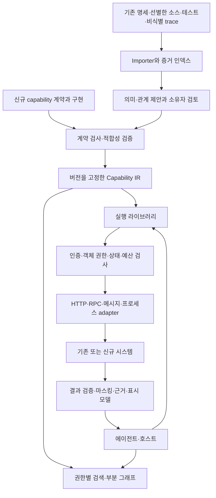

# a2api: API 분석과 아키텍처

작성일: 2026-10-28 · 상태: 검토용 설계 초안

2026-10-29 방향 재정렬: 이 문서는 최초의 넓은 설계 배경이다. 현재 필수 범위는 [제품 방향·전환·호출 설계](00-product-direction.ko.md)와 [개발 계획](03-roadmap-and-evaluation.ko.md)을 따른다. 아래의 모든 구성요소를 첫 사용 전에 구현할 요구로 해석하지 않는다.

## 1. 제안의 중심

**a2api는 API를 에이전트의 업무 단위로 재구성하는 계약, 컴파일러, 실행 라이브러리로 설계한다.**

공통 계약에서 검색용 설명, 입력 스키마, 관계 그래프, 실행 계획, 사용자 표시 모델, 평가 항목을 생성한다. 배포는 라이브러리 내장형과 별도 gateway/sidecar형을 모두 허용한다. 중앙 서버는 선택 사항이다.

초기에는 기존 HTTP API와 MCP를 이용한다. 독자적인 네트워크 전송 규약을 먼저 만들기보다, 업무 의미와 실행 규칙을 일관되게 표현하는 명세를 먼저 검증한다.

이 설계는 제공된 목표와 공개 표준에 근거한다. 현재 폴더에 레거시 코드가 없고 원격 접근도 완료되지 않아, 특정 서비스 구조·API 개수·성능을 조사한 결과는 아니다.

## 2. 클래식 API는 어떻게 개발하는가

### 일반적인 개발 과정

1. 도메인 모델과 사용 사례를 정하고, 리소스 또는 서비스 메서드의 책임을 나눈다.
2. 입력·출력 타입, 식별자, 오류, 인증·인가, 버전·호환성 규칙을 정한다.
3. HTTP 명세, IDL 또는 코드 선언으로 계약을 작성한다. 설계를 먼저 쓰는 방식과 구현에서 명세를 추출하는 방식이 모두 있다.
4. 라우터·컨트롤러·서비스·저장소와 외부 시스템 연결을 구현한다.
5. 계약·통합 테스트와 SDK·문서·예제를 만들고 배포·관측한다.
6. 클라이언트 개발자가 업무 절차를 코드로 조립한다. 호출 순서, 상태 보관, 화면 입력, 오류 복구는 이 코드에 들어가는 경우가 많다.

전통적 API도 컴퓨터 친화적이다. 차이는 **업무를 알고 있는 개발자가 클라이언트 코드를 미리 작성하는가, 실행 중 에이전트가 호출 계획을 구성하는가**에 있다. 잘 설계한 업무 API는 이미 에이전트에 적합할 수 있다.

### 계약과 구현 형태

| 형태 | 보통의 계약과 구현 | 잘 표현하는 것 | 에이전트 사용 시 추가로 확인할 것 |
|---|---|---|---|
| HTTP/REST 스타일 | OpenAPI, URI·메서드·상태 코드, 라우터와 서비스 | 요청·응답·인증·개별 operation | 업무 목적, 다음 단계, 실제 부작용, 성공 판정 |
| RPC/gRPC | IDL, protobuf, 생성한 stub와 서버 구현 | 메서드·메시지·타입, 스트리밍 | 여러 서비스의 순서, 도메인 식별자 의미, 중복 실행 |
| GraphQL | SDL, query/mutation/subscription, resolver | 객체 관계, 필요한 필드 선택 | 업무 상태 전이, 권한, 비용, mutation의 효과 |
| SOAP 계열 | WSDL/XSD, XML 메시지와 서비스 구현 | 메시지·인터페이스·binding | 도메인 상태와 사용자 업무 절차 |
| 이벤트·메시지 | AsyncAPI 등, producer/consumer, correlation ID | 채널·메시지·송수신 | 접수와 완료 구분, 중복·순서·지연, 조회 방법 |
| 언어 내부 라이브러리·CLI | 함수·클래스·헤더·명령·문서 | 로컬 호출 규칙 | 직렬화, 프로세스 수명, ABI, 포인터·자원 소유권 |

계약의 근거: [OpenAPI](https://spec.openapis.org/oas/v3.2.1.html), [gRPC](https://grpc.io/docs/what-is-grpc/core-concepts/), [GraphQL](https://graphql.org/learn/schema/), [WSDL](https://www.w3.org/TR/wsdl20-primer/), [AsyncAPI 3.0](https://www.asyncapi.com/docs/reference/specification/v3.0.0).

### 구현 언어와 접근 방식은 분리한다

Java, Node.js, Python, Rust, Go, C# 서비스가 이미 HTTP를 제공한다면 같은 HTTP adapter로 연결할 수 있다. 언어마다 전면 재작성할 필요가 없다.

소스에서 계약을 추출해야 할 때만 언어별 분석이 필요하다. Java/C#의 어노테이션·타입, TypeScript의 타입·라우트, Python의 타입 힌트·데코레이터, Go의 핸들러·구조체, Rust의 라우트·직렬화 타입 등을 보조 근거로 사용한다. 프레임워크·빌드 설정에 따라 추출 범위는 달라진다.

C/C++처럼 포인터·네이티브 자원·프로세스 전역 상태가 있는 코드는 특히 별도 프로세스 wrapper를 우선한다. 외부에는 직렬화 가능한 값과 명시적 resource handle을 제공한다. FFI가 필요한 경우 ABI·메모리 소유권·스레드 규칙을 별도 검증한다.

## 3. 많은 API를 그대로 노출하면 생기는 문제

| 문제 | 예 | a2api 설계 대응 |
|---|---|---|
| 선택 후보가 너무 많음 | `findOrder`, `getOrder`, `queryOrder` 중 잘못 선택 | 업무별 분류, 검색·재정렬, 사용/비사용 예 |
| 설명이 모델 문맥을 차지함 | 모든 도구의 긴 스키마를 매번 전달 | 요약 → 상세 계약 → 실행의 단계적 공개 |
| 문자열 타입만으로 의미를 구분하기 어려움 | `customerId`와 `accountId`를 혼용 | 도메인 타입과 식별자 namespace |
| 데이터 연결을 추측함 | 앞 응답의 `id`를 뒤 요청의 `id`로 전달 | 검토한 필드 매핑과 의미 타입 검사 |
| 선행 조건을 놓침 | 배송 ID를 조회하기 전에 추적 호출 | 의존성, 상태 조건, 필요한 정보 명시 |
| 접수·완료·부분 성공을 혼동함 | `202`를 업무 완료로 설명 | 작업 상태와 도메인 성공 조건 |
| 재시도가 부작용을 반복함 | 응답 유실 뒤 주문을 다시 생성 | 멱등성 근거, 실행 기록, 결과 재조회 |
| 사용자 의도와 효과가 어긋남 | 미리보기 요청에서 확정 처리 | prepare와 commit, 구체적 실행 범위 |
| 응답이 너무 크거나 해석하기 어려움 | 내부 코드·PII·수천 행 반환 | 필요한 필드, 페이지, 근거·단위·기준 시각 |
| 유효한 호출이 업무에는 틀림 | 권한은 있지만 다른 고객 주문을 선택 | 객체 권한, 식별자 출처, 모호성 해소 |
| 버전·상태가 바뀜 | 검색 시 계약과 실행 시 계약 불일치 | 계약 버전 고정, 실행 직전 재검증 |

이 문제들의 빈도와 개선 폭은 a2api 실험으로 측정해야 한다. 도구 수가 많다는 사실만으로 특정 실패율을 단정하지 않는다. API 검색·계획·호출을 나누어 평가하는 선행 연구로 [ToolLLM](https://arxiv.org/abs/2307.16789)과 [API-Bank](https://aclanthology.org/2023.emnlp-main.187/)를 참고한다. 이 연구의 과거 모델 성능을 현재 모델의 성능으로 해석하지 않는다.

## 4. 그래프를 만들면 무엇이 좋아지는가

### 서로 다른 세 그래프

| 그래프 | 예 | 용도 |
|---|---|---|
| 소스 호출 그래프 | controller → service → DAO | 구현 분석, 변경 영향 추적 |
| capability 관계 그래프 | 주문 조회 → 배송 ID 제공 → 배송 조회 | 도구 검색, 입력 출처와 의존성 확인 |
| 검증한 실행 그래프 | 고객 후보 선택 → 주문 조회 → 배송별 병렬 조회 → 결과 집계 | 업무 실행과 실패 복구 |

소스 호출 그래프를 그대로 에이전트의 실행 계획으로 쓰면 내부 구현 상세가 외부 업무 절차로 잘못 노출될 수 있다. GraphQL의 객체 그래프도 업무 실행 순서나 재시도 보장을 자동으로 제공하지 않는다.

### 그래프 모델

노드는 `Capability`, `Operation`, `EntityType`, `State`, `Policy`, `ErrorType`으로 시작한다.

관계는 의미가 다른 종류를 구분한다.

- `implementedBy`: 업무 기능을 어떤 operation 또는 workflow가 구현하는가.
- `produces` / `consumes`: 어떤 의미 타입을 출력·입력하는가.
- `requires`: 실행에 필요한 조건·자원·상태. 여러 필수 조건은 AND로 취급한다.
- `alternativeTo`: 같은 목적을 달성하는 대안. 후보를 모두 실행한다는 의미가 아니다.
- `transitions`: 어떤 도메인 상태를 변경하는가.
- `compensatedBy`: 가능한 보상 작업. 원상 복구 보장과 다르다.

실행용 관계에는 출력 JSON Pointer, 입력 위치, 엔티티 namespace, cardinality, 조건, 출처, 검토 상태를 둔다. `id: string`이 일치한다는 이유만으로 실행용 관계를 만들지 않는다.

예를 들어 `crm.CustomerId`와 `erp.CustomerId`는 서로 다른 타입이다. 실제 crosswalk API나 검증한 대응표가 있어야 연결한다. ID에는 테넌트·발급 시스템을 결부하고, 금액·날짜에는 통화·단위·시간대를 결부한다.

### 검색과 실행

1. 인증한 사용자·테넌트·권한에 따라 노출 가능한 카탈로그를 먼저 제한한다.
2. 업무 문구·용어 사전·예제의 키워드 검색과 의미 검색으로 후보를 찾는다.
3. 입력 의미 타입, 현재 상태, 부작용, 서비스 가용성으로 재정렬한다.
4. 후보의 필수 선행 조건을 포함한 작은 부분 그래프를 반환한다.
5. 에이전트 또는 상위 애플리케이션이 목적과 누락 정보를 결정한다.
6. 런타임은 검토한 실행 그래프를 타입·조건·예산 검사 후 수행한다.

권한 없는 선행 단계가 필요하면 전체 계획을 실행 불가로 표시하고, 허용되지 않은 세부정보는 감춘다. 그래프를 표시하는 것과 실행을 허용하는 것은 별도 판단이다.

초기 저장은 JSON과 관계 테이블·인덱스로 충분하다. 그래프 DB와 벡터 DB는 데이터 규모와 쿼리 측정 결과로 도입한다. 전체 API 쌍을 비교하는 방식은 피하고, 도메인·타입 인덱스로 연결 후보를 줄인다.

그래프는 탐색·연결을 개선하지만 잘못된 계약을 참으로 만들지는 못한다. 불완전한 문서, 숨은 상태 변경, 잘못 추론한 관계는 별도 검증이 필요하다.

## 5. 직접 노출, 그래프 전환, a2api native 비교

| 항목 | 기존 API 직접 노출 | 레거시를 구조화·그래프화 | 처음부터 a2api 계약으로 개발 |
|---|---|---|---|
| 출발점 | 기존 endpoint 또는 함수 | 기존 동작과 계약을 추출·보완 | 업무 목표와 실행 조건을 먼저 정의 |
| 도구 단위 | operation 중심이 흔함 | operation을 capability로 묶음 | 업무 단위를 설계하고 구현에 연결 |
| 의미 정보 | 문서·클라이언트 코드에 분산 | 추출 + 전문가 검토로 복원 | 계약에 직접 선언하고 구현 검증 |
| 호출 관계 | 에이전트가 추측하기 쉬움 | 매핑·조건·대안을 명시 | 구현·테스트와 같은 계약에서 관리 |
| 상태·부작용 | 기존 API 동작에 따름 | adapter가 통제할 수 있는 범위까지 | backend의 상태 전이·원자성까지 설계 가능 |
| 멱등성 | 기존 구현에 따름 | backend 지원이 없으면 보장에 한계 | 업무 키·결과 조회·저장 트랜잭션을 설계 가능 |
| 사용자 인터페이스 | 원시 응답을 해석 | 결과 변환과 표시 계약 추가 | 입력 해소·결과 근거·표시를 함께 설계 |
| 도입 비용 | 노출은 빠르나 운영 비용이 생김 | 점진 전환 가능, 의미 복원 비용 | 초기 설계 비용, 변경 시 일관성 확보 기회 |
| 잔여 위험 | 오선택·오조합·중복 실행 | 계약 drift와 backend 한계 | 계약 오류와 구현 불일치는 여전히 가능 |

**그래프 전환과 native는 서로 다른 최종 프로토콜이 아니다. 같은 Capability IR을 생산하는 두 경로다.** 레거시도 의미 정보와 backend 보장이 충분하면 native와 같은 계약을 제공할 수 있다. native의 이점은 필요한 보장을 처음부터 구현·검증하기 쉽다는 데 있다.

### 주문 취소 예시

직접 노출한 환경에서는 에이전트가 주문 조회, 배송 확인, 취소 가능 여부 조회, 취소, 환불 조회를 직접 선택하고 연결한다.

그래프 전환에서는 이 순서와 입력 매핑을 명시하고 `order.prepare_cancel` / `order.commit_cancel` 같은 업무 인터페이스로 감싼다. 그러나 기존 backend에 조건부 갱신이 없다면 준비 이후 출고가 진행되는 경쟁 조건을 wrapper만으로 완전히 제거할 수 없다.

native 개발에서는 준비 결과에 대상 버전·유효기간·효과를 포함하고, commit이 같은 버전과 조건을 backend 트랜잭션에서 다시 검사하도록 설계한다. 주문 취소와 환불 시스템이 분리되어 있으면 이 경우에도 분산 실패와 보상 규칙이 필요하다. 준비 API를 만든 사실만으로 분산 트랜잭션이 생기지는 않는다.

## 6. 기존 표준과 a2api의 경계

| 표준 | 재사용할 범위 | a2api가 정의할 추가 계약 |
|---|---|---|
| OpenAPI | HTTP operation·입출력·보안, Link Object | 업무 의미 타입·노출 단위·검증 근거 |
| OpenAPI Overlay | 원본을 수정하지 않는 설명·메타데이터 보강 | 어떤 의미·정책 필드를 추가하고 검토하는지 |
| Arazzo | 호출 순서·의존성·출력 전달·성공 조건 | 실행 정책·업무 의미·backend 보장과의 연결 |
| JSON Schema | 직렬화하는 입력·출력의 구조 검사 | 식별자 namespace·권한·상태에 대한 별도 검사 |
| MCP | 에이전트의 도구 발견·호출·구조화 결과 | 업무 카탈로그·의미 관계·실행 및 표시 계약 |

관계 정보와 workflow가 기존 표준에 전혀 없다는 전제로 개발하면 기능이 중복된다. 특히 [OpenAPI Link](https://spec.openapis.org/oas/v3.2.1.html#link-object), [Overlay](https://spec.openapis.org/overlay/v1.2.0.html), [Arazzo](https://spec.openapis.org/arazzo/v1.1.0.html)를 우선 가져온다.

[MCP 도구 명세](https://modelcontextprotocol.io/specification/2026-07-28/server/tools)는 입력·출력 스키마와 구조화 결과를 제공한다. a2api는 이를 adapter로 활용한다. 별도 업무 계약의 모든 의미가 MCP 필드로 일대일 보존되는 것은 아니므로, 실행 정책은 a2api 런타임에 둔다.

## 7. 전체 구성

개발 시 분석·계약 검토와 실행 시 데이터 처리는 분리한다. 실행 경로는 정적 계약과 검증한 변환을 사용한다. LLM이 추출한 설명이나 외부 응답 문구를 실행 권한으로 해석하지 않는다.

추천 패키지 경계는 `core/ir`, `importers`, `compiler`, `runtime`, `adapters`, `bridges/mcp`, `evals`다. 이는 향후 구조 제안이며 현재 구현된 디렉터리가 아니다.

## 8. 방대한 레거시를 전환하는 절차

### 1단계: 전체 소스보다 경계를 먼저 수집

외부 계약, gateway route, IDL, SDK, 통합 테스트를 먼저 조사한다. 지원하는 OpenAPI 등이 있으면 우선 사용한다. 없는 영역만 공개 entrypoint를 기준으로 소스 분석한다. 내부 private 함수까지 모두 도구로 만들지 않는다.

수집 결과에는 서비스·소유자·버전·배포 환경·호출량의 근거·데이터 민감도·변경 빈도를 기록한다. 실제 요청 trace는 허용된 범위에서 비식별화해 사용하고, 관측하지 못한 경로가 존재함을 남긴다.

### 2단계: 추출한 사실과 추론을 분리

타입·route·operation ID 등 추출 사실과, 업무 의미·부작용·관계 등 추론을 별도 관리한다. 필드별로 원본 파일·symbol·revision·추출기 버전·증거·검토자를 기록한다.

LLM은 설명·후보 관계·사용 예를 제안할 수 있다. 권한, 부작용, 멱등성, 상태 전이와 실행용 매핑은 소유자 검토 및 계약 테스트를 거쳐 활성화한다. 수치 confidence는 우선 검토 순서에만 쓰고 권한 판단에는 쓰지 않는다.

### 3단계: 업무별로 묶고 인터페이스를 보완

고객·주문·배송 같은 도메인으로 나누고, 빈도가 높으며 효과 범위를 설명할 수 있는 업무부터 전환한다. 원자 operation은 내부 registry에 남기고, 사용자와 에이전트에는 적절한 크기의 capability를 노출한다.

조회 업무는 배치·병렬 실행·페이지 처리를 조립할 수 있다. 변경 업무는 목적과 효과가 분명한 단위로 나누고 준비·검토·실행 경계를 둔다. 거대한 `do_everything` 도구와 수천 개의 미세 도구 모두 비교 평가가 필요하다.

### 4단계: 실행을 검증하고 점진적으로 배포

fixture·mock·격리한 테스트 환경에서 결과와 부작용을 확인한다. 조회 capability부터 시작하고 변경 capability는 별도의 적합성 조건을 통과시킨다. 운영 shadow 모드는 조회 또는 실행 없는 계획 비교에 한정한다. 실제 변경 호출을 복제하지 않는다.

### 5단계: 변경 부분만 갱신

파일·계약 hash와 symbol 의존성을 이용해 변경한 operation 및 연결된 capability만 재생성한다. 생성 결과와 사람이 작성한 overlay를 분리해 재추출 시 검토 내용을 보존한다. 삭제·의미 변경은 연결 관계를 무효화하고 재검토한다.

카탈로그 snapshot을 불변 버전으로 배포하고 실행 기록에 계약 버전을 남긴다. backend drift가 발견되면 해당 경로를 비활성화하거나 재검증한다. 다른 테넌트의 결과·검색 문맥을 공유 cache로 섞지 않는다.

## 9. 사용자 입력·출력도 계약의 일부

입력에는 사용자 제공 값, 인증 context, 앞 호출의 결과, 결정적 기본값을 구분한다. 인증 주체·테넌트·권한은 호스트가 주입한다. 에이전트가 임의 인자로 덮어쓸 수 없게 한다.

이름으로 고객이 여러 명 검색되면 후보 선택을 요청한다. 필수 식별자를 추측해 실행하지 않는다. 폼은 스키마에서 생성하되 단위·예제·허용값과 값의 의미를 함께 보여준다.

출력은 세 층으로 구성한다.

- `data`: 후속 호출과 검증에 쓰는 구조화 사실.
- `evidence/completeness`: 출처, 조회 시각, 누락·부분 실패, 페이지 범위.
- `presentation`: 사용자용 필드·라벨·표·상태 표시 제안.

사용자 표시에서 필드를 숨기는 것만으로 데이터 접근이 통제되지는 않는다. 모델·사용자 각각의 가시성은 서버가 실제 payload에서 강제한다. HTML 등 실행 가능한 UI 대신 안전한 선언적 표시 힌트부터 시작한다.

## 10. 이 설계에서 기대하는 효과와 남는 한계

검색은 선택 후보를 줄이고, 의미 타입과 그래프는 조합 실수를 줄이며, 실행 계약은 상태·재시도·실패 처리를 일관되게 만들 수 있다는 가설이다. 사용자 출력 계약은 사실과 요약의 연결을 검증하기 위한 수단이다.

그러나 adapter만으로 backend의 원자성·멱등성·일관성을 새로 보장할 수 없다. 도메인 의미 복원에는 담당자의 지식이 필요하고, 그래프와 workflow 자체도 유지보수 대상이다. 따라서 첫 목표는 자동 전환한 API 개수가 아니라 **대표 업무의 성공률과 운영 비용 개선을 측정하는 것**으로 둔다.
